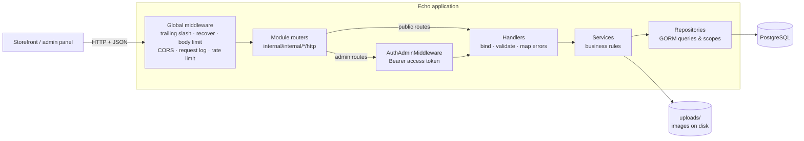
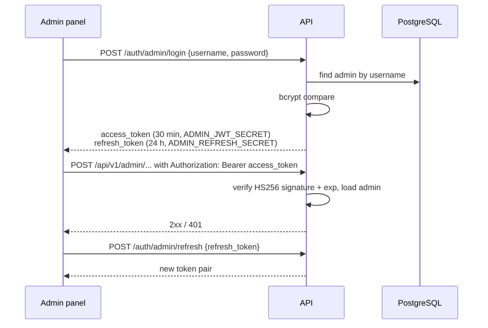
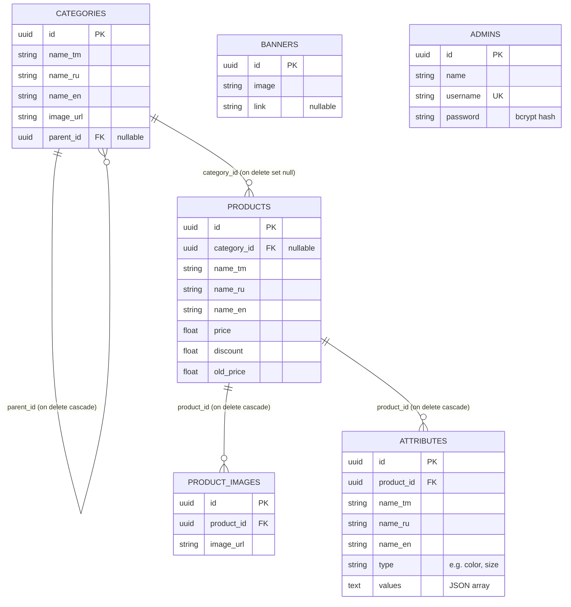
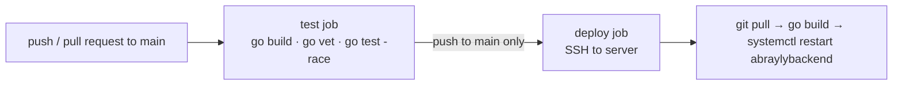

# Abraýly Mebel — Backend API

[](https://github.com/guvanch999/abrayly-mebel-backend/actions/workflows/ci.yaml)


REST API behind the online catalog of **Abraýly Mebel**, a furniture store.
It serves a trilingual (Turkmen / Russian / English) product catalog to the storefront and
provides the endpoints the store's admin panel uses to manage categories, products and banners.

Built with **Go**, **Echo v4**, **GORM** and **PostgreSQL**, and deployed through GitHub Actions
to a Linux server, where it runs as a systemd service.

---

## Contents

- [Features](#features)
- [Architecture](#architecture)
- [Data model](#data-model)
- [API overview](#api-overview)
- [Configuration](#configuration)
- [Running locally](#running-locally)
- [Testing](#testing)
- [CI/CD](#cicd)
- [Project structure](#project-structure)

## Features

- **Category tree.** Categories reference their parent (`parent_id`), so nesting can go any depth.
  `GET /api/v1/categories` returns the whole tree in one response. Deleting a category also deletes its
  subcategories (`ON DELETE CASCADE`). Its products stay in the database with `category_id = NULL`.
  The API rejects a move that would place a category under itself or under one of its own subcategories.
- **Products with attributes and images.** Each product has a price, a discount and an old price.
  It can carry any number of attributes, such as color, size or material, each with a name in all three
  languages. An attribute's values are stored as a JSON array through GORM's JSON serializer.
  Products can also have several uploaded images.
- **Catalog queries.** Pagination is capped at 100 items per page and lists are sorted newest first.
  You can filter by category and show only discounted products. A case-insensitive search (`ILIKE`)
  matches the product name in any of the three languages, and LIKE wildcards in the search text are escaped.
- **Recommendations.** For any product, the API returns other products from the same category.
- **Banners.** The admin can upload home-page banners, each with an optional link.
- **Admin authentication.**
  - Login returns a short-lived access token (30 min) and a refresh token (24 h).
    Both are HS256 JWTs, signed with different secrets.
  - Passwords are hashed with bcrypt.
  - Token checks accept only HS256 and require an expiry.
  - A login with an unknown username gets the same `401` response as a wrong password.
- **Safe uploads.** Only image types (`.jpg .jpeg .png .webp .gif .avif`) are accepted and stored under
  `uploads/`, which is served at `/uploads/*`. Files are removed when the record that owns them is deleted.
- **Operations.**
  - Configuration comes from environment variables and is validated at start-up.
  - `GET /health` checks the database connection.
  - On `SIGINT`/`SIGTERM` the server shuts down gracefully.
  - Requests are rate-limited per IP (20 req/s) and CORS origins are configurable.
  - Errors are returned as JSON. Unexpected errors are logged, and the client gets a generic `500`.
- **OpenAPI docs.** Swagger UI is served at `/swagger/index.html` and generated from the handler
  annotations with [swag](https://github.com/swaggo/swag).

## Architecture

Every feature module in `internal/internal/<module>` has the same layers. A router wires them
together, and each layer depends only on the one below it.



| Layer | Package | Responsibility |
|---|---|---|
| Router | `internal/internal/<module>/http` | Builds the module's repository, service and handler, then registers public and admin routes |
| Handler | `.../<module>/handler` | Parses path, query and body values, runs `validator` rules, returns the `{"data": ...}` envelope |
| DTO | `.../<module>/dto` | Request and response shapes, validation tags, pure helpers (pagination, category tree) |
| Service | `.../<module>/service` | Business rules: existence checks, re-parenting rules, file storage, token issuing |
| Repository | `.../<module>/repository` | Database access with GORM: filter and pagination scopes, transactions |
| Models | `internal/models` | GORM entities, auto-migrated on start-up when enabled |

Errors cross the layers as `exceptions.ResponseError`, which carries a status code.
`utils/errorHandler` turns every error into the same JSON shape:

```json
{ "code": 404, "message": "Not Found", "details": "product not found" }
```

### Admin authentication flow



## Data model



All entities also have `created_at` and `updated_at` columns, except attributes, images and banners.
IDs are UUIDs generated by the application.

## API overview

Swagger UI: **`http://localhost:3030/swagger/index.html`**. The [`http/`](http) folder has ready-made requests
for the JetBrains HTTP Client and the VS Code REST Client.

Successful responses use the envelope `{"data": ...}`. Collections are returned as `{"data": {"list": [...]}}`.
The product list endpoints return `{"data": {"total", "category_name", "data": [...]}}`.

### Public

| Method | Path | Description |
|---|---|---|
| `GET` | `/health` | Service and database health |
| `POST` | `/auth/admin/login` | Exchange admin credentials for an access + refresh token pair |
| `POST` | `/auth/admin/refresh` | Exchange a refresh token for a new pair |
| `GET` | `/api/v1/categories` | Full category tree |
| `GET` | `/api/v1/categories/{id}` | Single category |
| `GET` | `/api/v1/products` | Product list. Query: `page`, `limit` (≤ 100), `category_id`, `search`, `is_discount` |
| `GET` | `/api/v1/products/{id}` | Product with attributes, images and category |
| `GET` | `/api/v1/products/{id}/recommended` | Other products from the same category. Query: `page`, `limit` |
| `GET` | `/banners` | All banners |
| `GET` | `/banners/{id}` | Single banner |
| `GET` | `/uploads/*` | Uploaded images |

### Admin (requires `Authorization: Bearer <access_token>`)

| Method | Path | Description |
|---|---|---|
| `POST` | `/api/v1/admin/categories` | Create a category (multipart: names, optional `parent_id`, `image`) |
| `PUT` | `/api/v1/admin/categories/{id}` | Update names, parent, optionally the image |
| `DELETE` | `/api/v1/admin/categories/{id}` | Delete a category and its subcategories |
| `POST` | `/api/v1/admin/products` | Create a product |
| `PUT` | `/api/v1/admin/products/{id}` | Update a product |
| `DELETE` | `/api/v1/admin/products/{id}` | Delete a product with its images and attributes (one transaction) |
| `POST` | `/api/v1/admin/products/{id}/images` | Upload a product image |
| `DELETE` | `/api/v1/admin/products/{id}/images/{image_id}` | Remove a product image |
| `POST` | `/api/v1/admin/products/{id}/attributes` | Add an attribute with its values |
| `DELETE` | `/api/v1/admin/products/{id}/attributes/{attribute_id}` | Remove an attribute |
| `POST` | `/api/v1/admin/products/{id}/attributes/{attribute_id}/values` | Add a value to an attribute |
| `POST` | `/api/v1/admin/products/{id}/attributes/{attribute_id}/values/delete` | Remove a value from an attribute |
| `POST` | `/admin/banners` | Upload a banner (multipart: `image`, optional `link`) |
| `PUT` | `/admin/banners/{id}` | Change a banner's link |
| `DELETE` | `/admin/banners/{id}` | Delete a banner and its image |

Banner routes are not under `/api/v1`. That is how the storefront already calls them, so they were left as they are.

Example:

```bash
curl "http://localhost:3030/api/v1/products?search=diwan&is_discount=true&page=1&limit=12"
```

## Configuration

Settings come from environment variables. On start-up the service also loads a `.env` file from the
working directory if one exists. [`.env.example`](.env.example) lists every variable.

| Variable | Default | Description |
|---|---|---|
| `GO_ENV` | `production` | `development` turns on SQL query logging and points Swagger at `localhost` |
| `PORT` | `3030` | HTTP port |
| `APP_URL` | — | Public base URL in production, used as the Swagger host |
| `CORS_ALLOWED_ORIGINS` | `*` | Comma-separated list of allowed origins |
| `POSTGRES_HOST` | `localhost` | Database host |
| `POSTGRES_PORT` | `5432` | Database port |
| `POSTGRES_USER` | — | Database user |
| `POSTGRES_PASSWORD` | — | Database password (URL-escaped automatically) |
| `POSTGRES_DB` | — | Database name |
| `POSTGRES_SSLMODE` | `disable` | `disable`, `require`, `verify-ca` or `verify-full` |
| `DISABLE_AUTO_MIGRATION` | `true` | Set to `false` to create the `uuid-ossp` extension, run GORM auto-migrations and seed the first admin on start-up |
| `ADMIN_JWT_SECRET` | — **(required)** | Secret for signing access tokens |
| `ADMIN_REFRESH_SECRET` | — **(required)** | Secret for signing refresh tokens. Must be different from `ADMIN_JWT_SECRET` |
| `ADMIN_NAME` | `Administrator` | Display name of the first admin |
| `ADMIN_USERNAME` | `admin` | Username of the first admin |
| `ADMIN_PASSWORD` | — | Password of the first admin. If it is empty, no admin is seeded and a warning is logged. There is no built-in default |

The first admin is created only when auto-migration is enabled and the `admins` table is empty.

## Running locally

### With Docker Compose (API + PostgreSQL)

```bash
cp .env.example .env
# Edit .env: set POSTGRES_PASSWORD, both JWT secrets (openssl rand -hex 32) and ADMIN_PASSWORD
docker compose up --build
```

- API: <http://localhost:3030>
- Swagger UI: <http://localhost:3030/swagger/index.html>
- Health: <http://localhost:3030/health>

The image is a multi-stage build. The runtime stage is Alpine, the binary runs as a non-root user,
and there is a `HEALTHCHECK`. Uploaded images and database data are kept in named volumes.

### With a local Go toolchain

Requirements: Go 1.22+ and a running PostgreSQL instance.

```bash
cp .env.example .env      # point POSTGRES_* at your database and set the secrets
go run .                  # or: make run
```

Then log in with the seeded admin:

```bash
curl -X POST http://localhost:3030/auth/admin/login \
  -H "Content-Type: application/json" \
  -d '{"username":"admin","password":"<ADMIN_PASSWORD>"}'
```

The `docs/` folder is generated by swag from the handler annotations. Regenerate it after you change them:

```bash
make swagger   # go run github.com/swaggo/swag/cmd/swag@v1.16.4 init -g main.go -o docs
```

## Testing

```bash
go test ./...        # or: make test (adds -race)
```

The unit tests do not need PostgreSQL or any other service:

| Area | What is covered |
|---|---|
| Product repository | Filter SQL built with GORM `DryRun`: category, trilingual `ILIKE` search, discount, combined `AND`/`OR` grouping, wildcard escaping. Pagination, preloading of attributes and images, and the JSON-serialized attribute values, checked with `go-sqlmock`. Transactional delete and rollback |
| Category tree | Nesting at any depth, sibling order, orphans and cycles left out, `[]` for leaves |
| JWT | Issue and verify round trip. Rejection of a wrong secret, expired tokens, a missing `exp`, `alg: none`, HS512 and a non-UUID subject |
| Auth service | Login, uniform `401` for unknown users and wrong passwords, access and refresh tokens tied to separate secrets, refresh flow |
| Auth middleware | Parsing of the Bearer header, protected route behaviour with valid, expired and wrong-type tokens |
| Validation | Product, attribute, category, banner and login DTO rules |
| HTTP | Parsing of pagination and filter query parameters (defaults, cap, `400` on bad input), the JSON error handler, the health endpoint |
| Config & seeding | Defaults, empty values, secret validation, DSN escaping, admin seeding only when `ADMIN_PASSWORD` is set |
| Uploads | Allow-list of image extensions, storing and deleting files |

## CI/CD

[`.github/workflows/ci.yaml`](.github/workflows/ci.yaml):



- **test** runs on every push and pull request to `main`.
- **deploy** runs only when `test` passes on a push to `main` in the upstream repository. It never runs for
  pull requests or forks. It connects over SSH, pulls the latest code into the deployment directory,
  builds the binary and restarts the `abraylybackend` systemd unit.
- The server address, SSH user, private key and target directory come only from repository secrets:
  `REMOTE_HOST`, `REMOTE_USER`, `SSH_PRIVATE_KEY` and `REMOTE_TARGET`. Nothing about the server is stored in the repository.

## Project structure

```text
.
├── main.go                     # entry point: Swagger host, middleware, routes, graceful shutdown
├── cmd/server.go               # builds the Echo instance, config, DB connection, validator, error handler
├── docs/                       # generated OpenAPI spec (swag)
├── http/                       # example requests (JetBrains / VS Code REST Client)
├── internal/
│   ├── config/                 # env-based configuration + validation
│   ├── database/               # connection pool, auto-migration, admin seeding
│   ├── health/                 # GET /health
│   ├── middleware/             # global middleware, admin JWT middleware
│   ├── models/                 # GORM entities
│   ├── router.go               # registers all module routers
│   └── internal/
│       ├── admin/repository/
│       ├── auth/{dto,handler,http,service}/
│       ├── banner/{dto,handler,http,repository,service}/
│       ├── category/{dto,handler,http,repository,service}/
│       └── products/{dto,handler,http,repository,service}/
├── utils/
│   ├── errorHandler/           # JSON error responses
│   ├── exceptions/             # ResponseError + predefined HTTP errors
│   ├── util/                   # JWT, bcrypt, uploads, response wrappers
│   └── validator/              # go-playground/validator adapter for Echo
├── Dockerfile
├── docker-compose.yml
├── Makefile
└── .env.example
```
